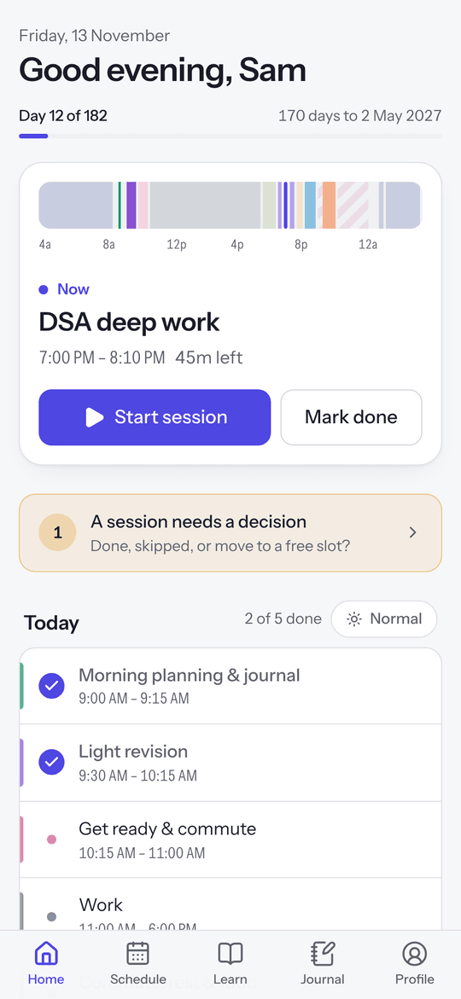
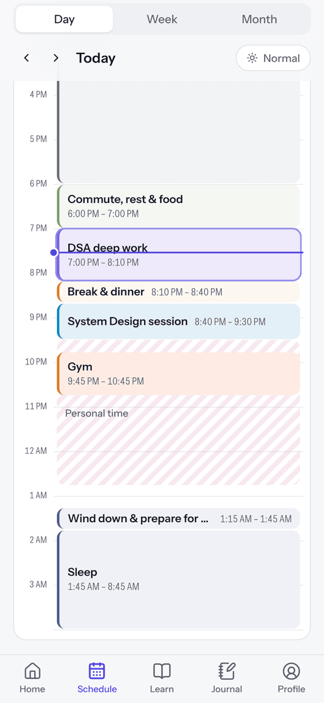
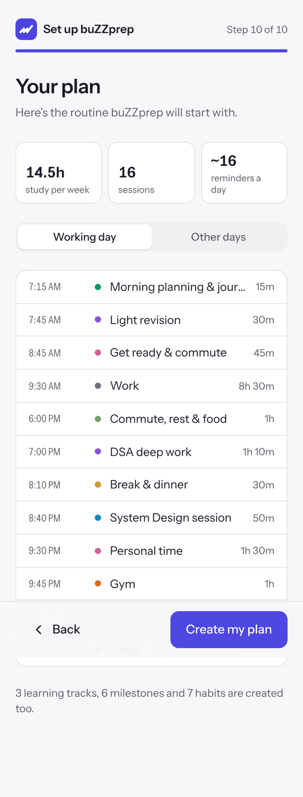

# buZZprep

A self-hosted app for preparing for technical interviews around a full-time job: a daily routine that fits your work hours and sleep, reminders that reach your phone, and progress you can trust. Install it on your iPhone or Android Home Screen like a native app; your plan and journal stay on your own server.

<p>
  
  
  
</p>

> **Status: early.** Scheduling, reminders, setup, the app shell and the night journal are built. Learn, Habits and Career are next. Web Push on iPhone is implemented to Apple's specification but **has not yet been verified on a physical device**; see [the test plan](docs/NOTIFICATIONS.md#real-device-test-plan-iphone).

## What it does

- **Builds your routine from a short setup.** Choose a goal (SDE, frontend or backend interviews, GATE, competitive programming, a new skill, a career change), your deadline, work hours, commute, current and target sleep, study time and gym days. buZZprep generates a weekly routine, reminders, learning tracks with topics and resources, milestones and target companies. Everything stays editable.
- **Shows today at a glance.** A strip of the whole day, what's on now and next, one tap to start or finish a session.
- **Adapts when life happens.** Mark a day as busy, low-energy or recovery and study blocks shrink or become optional, while work and sleep stay put. Missed sessions are never silently marked done: they wait for your decision, with free slots suggested.
- **Moves your sleep gradually.** Shift bedtime 15 minutes earlier every few days until you reach your target, without touching your wake-up time.
- **Reminds you at the right moment.** Reminders before sessions, when they start, if they weren't done, plus planning, journal, wind-down, bedtime, wake-up, weekly review and milestones, with quiet hours. Reminders are planned and sent by your server, not by a timer in the browser, so they don't depend on the app being open. (On iPhone this still needs verification on a real device.)
- **Ends the day with a journal, not a scroll.** A few minutes before bed, a reminder opens a quiet night screen: say (or type) what you studied, topic by topic. With an AI provider set up on your server, it becomes short revision notes, and each week's notes become a revision sheet and a weekend plan. Without one, everything except voice and generated notes still works.
- **Respects your privacy.** No public profiles, no analytics, no third-party scripts. Export everything or delete your account at any time.

Coming next: a DSA problem log that separates "solved on my own" from "solved with help", spaced revision (1, 3, 7, 14, 30 days), system design and CS fundamentals tracking, habits without guilt, and a career pipeline. See the [roadmap](docs/ROADMAP.md).

## Getting started

### Run it on your server

You need a Linux server with Docker and a subdomain pointing at it.

```bash
git clone https://github.com/<you>/buZZprep.git && cd buZZprep
cp .env.example .env                       # set domain, secrets, invite code
docker compose build
docker compose run --rm --no-deps app node apps/server/dist/generate-vapid.js   # paste keys into .env
docker compose up -d
```

Caddy obtains an HTTPS certificate automatically. Open `https://your-subdomain`, create your account, and add the app to your Home Screen. The full guide, including nginx, backups and updates, is in [docs/DEPLOYMENT.md](docs/DEPLOYMENT.md).

### Develop locally

Requires Node.js 22.12+ and Docker (for MongoDB). No `.env` file is needed on your computer.

```bash
npm install
npm run dev:db          # MongoDB in Docker on 127.0.0.1:27017
npm run dev             # API on :4000, app on http://localhost:5173
```

```bash
npm test                # unit tests
MONGODB_TEST_URI=mongodb://127.0.0.1:27017/buzzprep_test npm test   # + API integration tests
npm run typecheck && npm run lint
```

## Your personal setup

Your details (job, schedule, targets) are never part of the code. Either answer the setup wizard, or keep them in a config bundle such as `config/personal.local.json` (ignored by git) and import it from **Profile → Import configuration** or the command line. See [config/README.md](config/README.md).

## Notifications on iPhone

iOS delivers web push notifications only to apps added to the Home Screen (iOS 16.4 or later; 18.4 or later recommended). In Safari: **•••** → **Share** → **Add to Home Screen**, open buZZprep from the Home Screen, sign in, then **Profile → Notifications → Turn on reminders**. iOS doesn't support notification buttons, silent pushes or background sync for web apps; [docs/NOTIFICATIONS.md](docs/NOTIFICATIONS.md) explains what that means and what buZZprep does instead.

## Documentation

| Document                                  | Contents                                                           |
| ----------------------------------------- | ------------------------------------------------------------------ |
| [Architecture](docs/ARCHITECTURE.md)      | System design, repository structure, key decisions                 |
| [Data model](docs/DATA_MODEL.md)          | Collections, fields, indexes, retention                            |
| [API](docs/API.md)                        | REST endpoints and conventions                                     |
| [Notifications](docs/NOTIFICATIONS.md)    | Delivery pipeline, iOS feasibility analysis, real-device test plan |
| [Deployment](docs/DEPLOYMENT.md)          | Self-hosting on a subdomain, backups, updates, local development   |
| [Roadmap](docs/ROADMAP.md)                | Phases, current status, technical debt                             |
| [Screens](docs/WIREFRAMES.md)             | Screenshots and wireframes                                         |
| [Configuration bundles](config/README.md) | Seed and import/export format                                      |

## Built with

React 19, TypeScript, Vite, Tailwind CSS v4, Radix UI, React Router, TanStack Query, Zustand and Workbox on the client; Node.js, Express 5, MongoDB with Mongoose and Web Push (VAPID) on the server; Docker Compose with Caddy for deployment. The scheduling and reminder engine is a dependency-light TypeScript package shared by both sides.

## Contributing and security

Contributions are welcome: see [CONTRIBUTING.md](CONTRIBUTING.md). To report a vulnerability, follow [SECURITY.md](SECURITY.md) instead of opening a public issue.

## License

[MIT](LICENSE). The welcome page's animations use [GSAP](https://gsap.com), which is free to use under its own [Standard "No Charge" licence](https://gsap.com/standard-license) rather than MIT.
