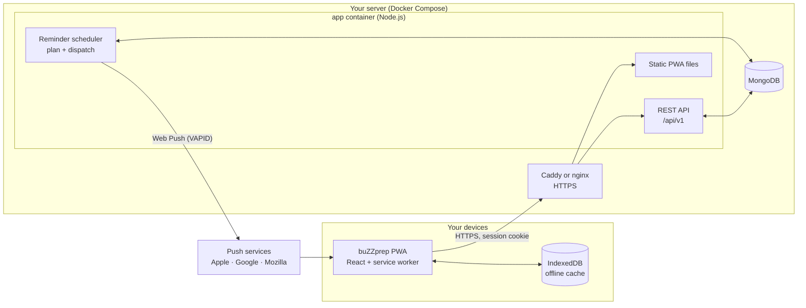
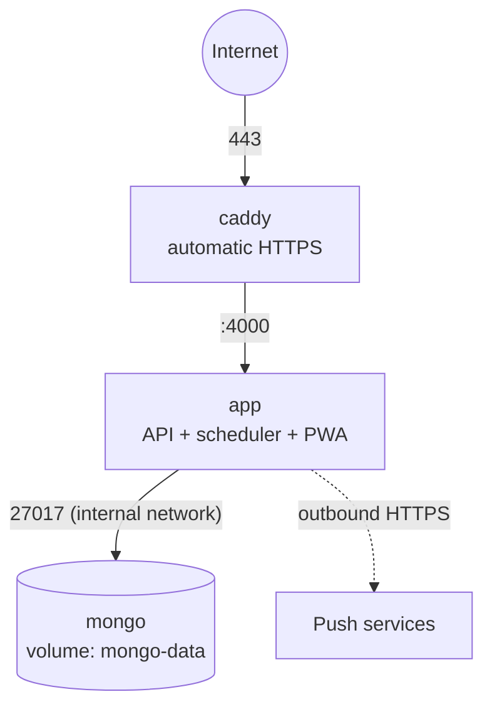

# Architecture

buZZprep is a **modular monolith**: one Node.js process serves the API, runs the reminder scheduler and serves the built PWA, backed by MongoDB. It is designed so one person can self-host it on a small VPS, while keeping clear module boundaries so pieces can be split out later.

- [System overview](#system-overview)
- [Repository structure](#repository-structure)
- [Code organisation](#code-organisation)
- [Domain engine](#domain-engine-packagesshared)
- [Server](#server-appsserver)
- [Web app](#web-app-appsweb)
- [Security and privacy](#security-and-privacy)
- [Deployment topology](#deployment-topology)
- [Decisions](#decisions) (including two that need your approval)

Related: [DATA_MODEL.md](DATA_MODEL.md) · [API.md](API.md) · [NOTIFICATIONS.md](NOTIFICATIONS.md) · [DEPLOYMENT.md](DEPLOYMENT.md)

## System overview



Three ideas carry most of the design:

1. **The server owns time.** Schedules, missed-session detection and reminders are computed on the server from data in MongoDB. Nothing depends on a browser being open or a JavaScript timer surviving.
2. **One pure domain engine, shared by server and client.** Time arithmetic, recurrence, agenda expansion, reminder planning, spaced revision and habit streaks are pure TypeScript functions in `packages/shared`, tested without a database. The server uses them to persist and notify; the web app uses the same code to preview a plan during setup.
3. **Your data is yours.** Every record belongs to exactly one user, every query is scoped to the signed-in user, there are no public profiles, and everything can be exported or deleted. Personal defaults live in an optional, git-ignored config file, never in the source code.

## Repository structure

```
buZZprep/
├── apps/
│   ├── server/                 Express 5 API, scheduler, Web Push (TypeScript, Mongoose)
│   │   ├── src/
│   │   │   ├── config/         Environment parsing and validation (zod)
│   │   │   ├── db/             Connection, and one file per Mongoose model in models/
│   │   │   ├── middleware/     auth (sessions), csrf, rate-limit, security-headers, error-handler
│   │   │   ├── modules/        One folder per area: *.routes.ts (HTTP) and *.service.ts (logic, data)
│   │   │   │   ├── auth/ account/ profile/ plans/ onboarding/ config/ reminders/
│   │   │   │   ├── schedule/   Schedules, activities, agenda, occurrences, day modes
│   │   │   │   ├── notifications/  Outbox planner and dispatcher, push sender, payloads, history
│   │   │   │   └── dashboard/ meta/
│   │   │   ├── lib/            Crypto helpers, errors, logging, parameter parsing, serialisation
│   │   │   ├── routes.ts       The /api router: shared middleware, then every module's router
│   │   │   ├── context.ts      What routers receive: the environment and the notification service
│   │   │   ├── app.ts          Express app (security headers, /api, the PWA, error handling)
│   │   │   ├── web.ts          Serves the built PWA with the right caching
│   │   │   └── index.ts        Process entry point (API and/or scheduler by APP_ROLE)
│   │   ├── scripts/            build (esbuild), generate-vapid, import-config, reset-password
│   │   └── test/               Unit tests + API integration tests (need MongoDB)
│   └── web/                    React 19 PWA (Vite, Tailwind v4, Radix)
│       ├── src/
│       │   ├── app/            App root, router, signed-in layout, sign-in guard, SW registration
│       │   ├── api/            HTTP client, query cache with offline persistence, response types
│       │   ├── components/     Page chrome, and the design system in ui/ (one component per file)
│       │   ├── features/       One folder per area: auth, dashboard, schedule, onboarding, …
│       │   │   └── <feature>/  api.ts, a *Page.tsx per route, components/, hooks/
│       │   ├── lib/            Shared clock, formatting, device capability checks, theme
│       │   ├── sw.ts           Service worker: precache, offline navigation, push
│       │   └── styles.css      Design tokens (light/dark) and utilities
│       ├── assets/             Icon sources (SVG)
│       └── public/             Generated icons, theme bootstrap
├── packages/
│   └── shared/                 Domain engine + zod schemas used by both apps
│       ├── src/
│       │   ├── time/           Local dates and times, recurrence
│       │   ├── schedule/       Agenda expansion, day modes, occurrence status, free slots
│       │   ├── reminders/      Reminder rules into planned notifications, quiet hours, wording
│       │   ├── learning/       Spaced revision, preparation progress
│       │   ├── habits.ts       Streaks and consistency
│       │   ├── constants/      Categories, modes, reminder kinds and other fixed lists
│       │   ├── schemas/        Request and config-bundle validation (zod)
│       │   ├── templates/      Preparation templates (catalog/) and the plan generator (generate/)
│       │   └── index.ts        The package's public API
│       └── test/
├── config/                     Your optional seed configuration (*.local.json is git-ignored)
├── deploy/                     Caddyfile and an nginx example
├── docs/                       This documentation
├── scripts/                    Repo tooling (icon generation)
├── Dockerfile                  One image: API + scheduler + built PWA
├── docker-compose.yml          Production: app + MongoDB + Caddy
└── docker-compose.dev.yml      Local MongoDB for development
```

npm workspaces tie the three packages together. `packages/shared` is consumed as TypeScript source (no build step): Vite compiles it into the web bundle and esbuild bundles it into the server build.

## Code organisation

These conventions keep each kind of code in one predictable place. `npm run lint` enforces the two marked ✱.

### Server modules

Each area of the API is a folder in `apps/server/src/modules/` with two kinds of file:

- **`<name>.routes.ts` handles HTTP only.** A handler parses the input with the shared zod schema, calls the service with the signed-in user's id, and sends the result. After a change that can affect reminders it calls `ctx.notifications.queueReconcile(userId)`.
- **`<name>.service.ts` holds the logic and the database access.** Services take plain values (a user id, parsed input) and return plain objects. They never see `req` or `res`, so scripts and tests call them directly; `scripts/import-config.ts` uses the same import service as the API.
- ✱ Routes don't import Mongoose or the models.
- Every router is mounted in `src/routes.ts`, the one place that lists the endpoint prefixes. A new endpoint needs a schema in `packages/shared/src/schemas/` if it takes input, a service function, a handler, and an entry in [API.md](API.md).

### Domain engine

`packages/shared/src` is grouped by domain. Each folder's `index.ts` re-exports what other code may use, and `src/index.ts` re-exports those, so the apps import from `@buzzprep/shared` and nothing deeper. Code here is pure: no I/O, no database, and no clock reads (the current time is always passed in).

### Web app

- **Layers.** `app/` assembles the features into routes. `api/`, `components/` and `lib/` are shared by every feature; ✱ they never import from `features/`.
- **A feature folder** holds `api.ts` with the feature's TanStack Query hooks and request functions (components never build URLs), one `*Page.tsx` per route, and `components/` and `hooks/` for the pieces those pages use. Onboarding keeps its wizard steps, with the check that gates each one, in `steps/`.
- **Between features**, import only another feature's `api.ts`, hooks and components. The dashboard reuses the schedule's session rows and sheets, and every feature reads the time zone and day boundary through `features/profile/hooks/useTimeContext`. Inside a feature, siblings are imported with relative paths.
- **Query keys** sit next to their query in `api.ts`. Mutations that must survive going offline get their defaults in `api/query-client.ts`, which loads before the persisted cache is restored, so a change queued offline resumes after the app restarts.
- **`components/ui/`** holds small presentational components, one per file, named in kebab case like their shadcn/ui counterparts.
- **Logic that is easy to get wrong** (form conversions, formatting, device checks) lives in its own module, with tests in a `__tests__/` folder beside it.

## Domain engine (`packages/shared`)

### Time model

- **Dates and times are local strings**: `"2026-11-16"` and `"19:00"`, always interpreted in the time zone stored in your profile (an IANA name such as `Asia/Kolkata`), not the device's. Instants (`Date`, ISO strings) are used only where something happens at an absolute moment: notification fire times, completion timestamps.
- **A day starts at 04:00 by default** (`dayBoundaryMinutes`, configurable). Anything between midnight and 04:00 belongs to the previous day, so a 1:15 AM bedtime is part of _today's_ plan, the way people actually think about late nights.
- Conversions between local times and instants go through Luxon, so daylight-saving gaps and overlaps resolve consistently for users in zones that observe DST.

### Schedules

- A **schedule** (routine) is a named set of **activities**. You can keep several (for example "Normal" and "Exam month") and switch the active one.
- An **activity** has a start time, duration, recurrence (`once`, `daily`, `weekly` with weekdays, `monthly` with day of month or last day), category, priority, and flags:
  - `essential`: never shortened or skipped by day modes (work, sleep);
  - `blocking`: whether it occupies time for free-slot search (personal time doesn't);
  - `progression`: a gradual shift, such as moving bedtime 15 minutes earlier every 3 days until it reaches the target, optionally keeping the wake-up time fixed.
- **Occurrences are computed, not stored.** `expandAgenda()` expands activities into concrete sessions for any date range. A row in `activityoccurrences` exists only when something happened to a session: completed, skipped, moved, or annotated. Editing the routine therefore changes the future immediately while the past keeps its history, and no background job has to "generate" days.
- **Day modes** (normal, busy, low energy, recovery) adjust one day or a range of days. Mode rules map categories to keep / shorten / make optional / skip, and can be customised per user. Essential activities are never touched.
- **Missed sessions are never auto-completed or silently dropped.** A trackable session that ended more than 30 minutes ago (configurable) without being marked becomes _needs a decision_: done, skipped, or moved. Moving offers free slots from `suggestSlots()`, which avoids blocking activities and quiet hours.

### Reminders

`planNotifications()` turns reminder rules plus the agenda into a list of concrete notifications for a time window, each with a deterministic dedupe key, a condition (for example "only if still pending"), urgency, time-to-live and maximum lateness, and a suppression reason (quiet hours, type turned off, category muted). It is pure and fully tested; the server persists its output. See [NOTIFICATIONS.md](NOTIFICATIONS.md).

### Learning, habits and progress

- **Spaced revision** (`learning/revision.ts`): intervals default to 1, 3, 7, 14 and 30 days and are configurable. Solving independently advances a stage; needing hints repeats it; needing the editorial or not solving it resets it. A problem first solved with help is never later counted as "first solved independently".
- **Habits** (`habits.ts`): streaks skip rest days and allow a configurable number of misses per week; consistency is reported as a rate over a window, and a "comeback" is recognised after a gap, so a missed day never resets visible progress to zero.
- **Templates** (`templates/`): eight preparation templates (SDE interviews, frontend, backend, GATE, competitive programming, a new skill, career transition, blank) and `generateBundle()`, which turns the setup wizard's answers into a full plan: routine, reminders, learning tracks with topics and resources, milestones, habits and target companies.

## Server (`apps/server`)

- **Express 5** with a module per feature (see [Code organisation](#server-modules)). Routes validate input with the same zod schemas the client uses, call the module's service, and return JSON. Errors are mapped centrally to `{ error: { code, message, issues? } }`.
- **Process roles.** `APP_ROLE=all` (default) runs the API and the scheduler in one process. `api` and `worker` split them into separate containers when needed. Startup creates indexes explicitly and retries the database connection.
- **Reminder scheduler.** Two loops: _reconcile_ re-plans every user's next 36 hours every 10 minutes (and a specific user's window about 1.5 seconds after they change something), and _dispatch_ sends due rows every 15 seconds. Both are guarded against overlap, and the outbox claim is atomic, so running several workers is safe.
- **Static hosting.** In production the same process serves the built PWA with long-lived caching for hashed assets and `no-cache` for `index.html` and `sw.js`, so updates reach devices promptly.
- **Logging** uses pino (JSON in production). Request logs exclude bodies.

## Web app (`apps/web`)

- **React 19 + React Router 8** (data router, lazy-loaded routes).
- **Navigation, one layout per screen size** (`app/AppShell.tsx`, pieces in `app/components/`). The navigation surfaces share a deep ink colour (`--chrome`), dark in both themes:
  - **Phones** (under 768 px): an ink top bar that starts under the status bar, so the Dynamic Island sits inside it, with the logo, the days left in your plan and a shortcut to notifications. The page sits beneath it like a sheet, and a tab bar (Home, Schedule, Learn, Journal, Profile) sits above the home indicator.
  - **Tablets, and phones held sideways** (768–1023 px): a narrow ink rail with the main places and an account button. It keeps clear of the Dynamic Island when the phone is sideways.
  - **Laptops and desktops** (1024 px and up, including iPad in landscape): an ink sidebar with the main places, shortcuts into your plan (routine, sessions that need a decision, goal and milestones), plan progress and an account menu.
- **Edge to edge on iOS.** The Home Screen app uses `black-translucent`, so the page draws behind the status bar. Every screen gives that strip the ink colour, either through the top bar or `StatusBarBackdrop`, because the status bar text is white. Safe-area insets are read once into `--safe-top/right/bottom/left` in `styles.css`, and layouts use those variables.
- **Server state** lives in TanStack Query. The cache is persisted to IndexedDB, so the last-known agenda and dashboard open instantly and work offline. Marking a session done or skipped while offline is queued and replayed when the connection returns.
- **UI state** (theme, a shared minute clock) uses small Zustand stores.
- **Design system**: Tailwind CSS v4 with tokens defined in `styles.css` (light and dark), and components built on Radix primitives in the style of shadcn/ui. Instrument Sans for the interface; Newsreader is reserved for long-form writing in the journal. Indigo is reserved for "now" and primary actions.
- **PWA**: web app manifest with maskable icons and shortcuts, iOS meta tags, safe-area handling, and a custom service worker (`src/sw.ts`, built with Workbox via `vite-plugin-pwa` in `injectManifest` mode) that precaches the app shell, serves offline navigation, and handles push events, clicks and subscription changes. When a new version is deployed, the app shows "A new version of buZZprep is ready" with an **Update** button instead of reloading while you're using it.

## Security and privacy

Summary; details in [SECURITY.md](../SECURITY.md).

- **Accounts**: argon2id password hashing; sessions are random tokens stored hashed in the database and sent as `HttpOnly`, `Secure`, `SameSite=Lax` cookies (`__Host-` prefixed over HTTPS), so they can be revoked and aren't readable by JavaScript.
- **CSRF**: state-changing requests must come from an allowed origin and carry the `X-Requested-With: buzzprep` header, which cross-site forms can't set.
- **Rate limits** on all API calls, stricter ones on sign-in, registration, password change, export, import and account deletion.
- **Headers**: helmet with a strict Content-Security-Policy (no third-party scripts, fonts are self-hosted).
- **Registration**: `open`, `invite` (requires `INVITE_CODE`) or `closed`. The first account on a new server becomes the admin.
- **Isolation**: every query filters by the session's user id; there are no public profiles or shared journals. Notification acknowledgements from the service worker are authorised by a short-lived HMAC token tied to that notification and user.
- **Secrets** (session secret, VAPID private key, database password) come from the environment and are never sent to the browser. The client only receives the VAPID public key.
- **Data rights**: download everything as JSON; delete your account and all of its data (requires your password and typing DELETE).

## Deployment topology



- The app's port is bound to `127.0.0.1` only; the proxy is the only public entry point.
- MongoDB is reachable only on the Compose network and requires a password.
- To scale out, run one `worker` container and any number of `api` containers behind the proxy. See [DEPLOYMENT.md](DEPLOYMENT.md).

## Decisions

Each decision lists what was chosen, why, and what it costs. Two of them deviate from or extend the original brief and **need your approval** before more is built on top of them.

### D1. MongoDB outbox + in-process scheduler instead of BullMQ and Redis — _needs approval_

**Chosen:** reminders are rows in a `notifications` collection (the outbox), with a unique dedupe key per reminder. A loop in the Node process claims due rows atomically (status + lease), sends them and records the result.

**Why:** it is durable (a reminder exists in the database before its time comes, survives restarts and can be inspected), idempotent (re-planning can't create duplicates), safe with several workers (atomic claims), and it removes a whole service (Redis) from what a self-hoster must run, back up and secure. The query is indexed on `{ status, fireAt }` and touches only due rows.

**Costs:** dispatch granularity is the tick interval (15 s by default). Polling adds a small, constant load on MongoDB. At very large scale (tens of thousands of active users) a dedicated queue would be more efficient.

**Revisit when:** sub-second precision is needed, or one worker can't keep up. Dispatch is isolated in `OutboxDispatcher` (`modules/notifications/outbox-dispatcher.ts`) behind the `NotificationService` facade, so swapping in BullMQ means replacing the dispatch loop, not the planner or the data model.

### D2. TanStack Query for server state — _needs approval_

The brief names Zustand for state. Zustand is used for UI state, but server data (agenda, profile, notifications) uses TanStack Query because it provides caching, background refresh, request de-duplication, an IndexedDB-persisted cache for offline reading, and paused/resumed offline mutations. Re-implementing those on Zustand would be a significant amount of fragile code. Cost: one more dependency, a little over 10 kB gzipped.

### D3. Modular monolith with process roles

Per the brief. One image and one process by default; `APP_ROLE` splits the API and scheduler without code changes. Modules talk through models and small services, not HTTP.

### D4. Computed occurrences with exception rows

Instead of materialising every future session into the database, sessions are expanded on demand and only deviations (done, skipped, moved, notes) are stored. Routine edits apply to the future instantly, and storage grows with what you do, not with the calendar. Cost: agenda reads do some computation (cheap: about 15 activities × 62 days at most per request).

### D5. Local date/time strings + profile time zone

Schedules are about wall-clock times ("7 PM every weekday"), not instants. Storing local strings and converting at the edges avoids a class of time-zone and DST bugs, and makes travel explicit: change your profile's time zone and the routine follows.

### D6. Cookie sessions instead of JWTs in local storage

Server-side sessions can be listed and revoked (password change signs out other devices), and `HttpOnly` cookies are not exposed to injected scripts. The same-origin PWA makes cookies simple; iOS keeps a separate cookie jar for the installed app, which is why you sign in once inside it.

### D7. Declarative Web Push payloads

All pushes use the Declarative Web Push format with `mutable: true`. iOS 18.4+ can display them even if the service worker is gone; other browsers treat them as ordinary JSON payloads handled by the service worker. One format, no per-platform branches on the server.

### D8. One config-bundle format

Templates, the setup wizard's output, your personal seed file and data import/export all use the same versioned JSON format (`format: "buzzprep.config", version: 1`), validated by one schema. Records reference each other by `ref` names rather than database ids, so bundles are portable between servers.

### D9. No AI features in the first release

Per the brief. Nothing in the data model prevents adding them later; problem attempts already distinguish "solved independently" from "needed help", which any future assistant must respect.

### D10. Toolchain

TypeScript 6 in strict mode (TypeScript 7's native compiler is not yet supported by typescript-eslint), Vite 8, Vitest, ESLint 10 with React Hooks rules, Prettier. Node 22.12+ (the Docker image uses Node 24 LTS).
