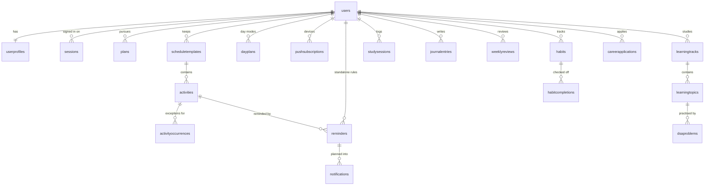

# Data model

MongoDB, accessed through Mongoose. Models live in `apps/server/src/db/models/`; validation of incoming data uses the zod schemas in `packages/shared/src/schemas/`.

**Conventions**

- Every document except `users` has a `userId`, and every query filters by the signed-in user's id. There is no cross-user data and no public view of anything.
- Local dates are strings `YYYY-MM-DD` and local times `HH:mm`, interpreted in the profile's time zone. Absolute moments (`createdAt`, `fireAt`, `completedAt`) are `Date`s in UTC.
- Most documents have `createdAt` / `updatedAt` timestamps (omitted below).
- Indexes are created explicitly at startup (`autoIndex` is off), so production never builds indexes implicitly.
- `USER_OWNED_MODELS` in `models/index.ts` lists every per-user collection. Account export and account deletion iterate over it, so a new collection only needs to be added there to be covered.

## Accounts

### `users`

| Field                              | Notes                                                      |
| ---------------------------------- | ---------------------------------------------------------- |
| `email`                            | Lower-cased, unique.                                       |
| `passwordHash`                     | argon2id. Never returned by the API.                       |
| `displayName`                      | Shown in greetings.                                        |
| `role`                             | `user` or `admin`. The first account on a server is admin. |
| `lastLoginAt`, `passwordChangedAt` |                                                            |

### `sessions`

| Field                     | Notes                                                               |
| ------------------------- | ------------------------------------------------------------------- |
| `userId`                  |                                                                     |
| `tokenHash`               | SHA-256 of the cookie token. The raw token is never stored. Unique. |
| `expiresAt`               | Rolling; a TTL index deletes expired sessions automatically.        |
| `lastSeenAt`, `userAgent` | For a future "signed-in devices" list.                              |

### `userprofiles` (one per user)

Person-level settings. Everything the setup wizard asks lives here or on the plan, never in code.

| Field                                        | Notes                                                                                                             |
| -------------------------------------------- | ----------------------------------------------------------------------------------------------------------------- |
| `timezone`                                   | IANA name, e.g. `Asia/Kolkata`.                                                                                   |
| `dayBoundaryMinutes`                         | When a new day starts, in minutes after midnight. Default 240 (04:00).                                            |
| `weekStartsOn`                               | 1 (Monday) or 7 (Sunday).                                                                                         |
| `professional`, `education`                  | Optional free-form details (designation, organisation, degree, grade…).                                           |
| `work`, `sleep`, `study`, `fitness`          | Working days and hours, commute, pressure; current and target sleep; study minutes; gym.                          |
| `restDays`                                   | Weekdays treated as rest days for habits.                                                                         |
| `skills`                                     | Self-assessed levels per area and notes.                                                                          |
| `notifications`                              | Reminder preferences: master switch, quiet hours, kinds on/off, muted categories, snooze length, 12/24-hour time. |
| `revisionIntervals`                          | Spaced-revision intervals in days. Default `[1, 3, 7, 14, 30]`.                                                   |
| `missedGraceMinutes`                         | How long after a session ends before it needs a decision. Default 30.                                             |
| `theme`                                      | `system`, `light` or `dark`.                                                                                      |
| `modeRules`                                  | Optional per-user overrides of what busy / low-energy / recovery days do.                                         |
| `onboardingAnswers`, `onboardingCompletedAt` | The setup wizard's answers, kept so "Reset to default schedule" can regenerate the plan.                          |

### `plans`

The preparation journey: goal, dates and milestones. One plan is `active` at a time.

| Field                                                       | Notes                                                    |
| ----------------------------------------------------------- | -------------------------------------------------------- |
| `title`, `goalType`, `targetRole`, `description`            |                                                          |
| `targetCompanies`, `stretchCompanies`, `compensationTarget` |                                                          |
| `startDate`, `deadline`                                     | Local dates. Drive "Day 12 of 182" and milestone pacing. |
| `status`                                                    | `active`, `paused`, `completed`, `archived`.             |
| `milestones[]`                                              | `{ title, dueDate, completed, completedAt, note }`       |
| `sourceTemplate`                                            | Which template generated it, if any.                     |

## Scheduling

### `scheduletemplates`

Named routines ("My routine", "Exam month"). `isActive` marks the one in use.

### `activities`

| Field                           | Notes                                                                                                                                                               |
| ------------------------------- | ------------------------------------------------------------------------------------------------------------------------------------------------------------------- |
| `templateId`                    | The routine it belongs to.                                                                                                                                          |
| `title`, `description`, `notes` |                                                                                                                                                                     |
| `category`                      | `dsa`, `system_design`, `cs_fundamentals`, `job`, `gym`, `sleep`, `food`, `personal`, `journaling`, `rest`, `custom`.                                               |
| `startTime`, `durationMinutes`  | Local time and length. May cross midnight.                                                                                                                          |
| `recurrence`                    | `{ freq: 'once', date }`, or `{ freq: 'daily' \| 'weekly' \| 'monthly', interval, startDate, endDate?, byWeekday? (weekly), byMonthDay? (monthly, -1 = last day) }` |
| `priority`                      | `low`, `medium`, `high`, `critical`.                                                                                                                                |
| `essential`                     | Never changed by day modes.                                                                                                                                         |
| `blocking`                      | Occupies time for free-slot search. `false` for flexible personal time.                                                                                             |
| `trackId`                       | Optional link to a learning track.                                                                                                                                  |
| `modeBehavior`                  | Optional per-activity override of day-mode rules.                                                                                                                   |
| `progression`                   | Optional gradual shift: `{ fromTime, stepMinutes, everyDays, startDate, keepEnd }`.                                                                                 |
| `archived`                      | Deleting an activity archives it so past history stays readable.                                                                                                    |

### `activityoccurrences`

Exceptions only; sessions themselves are computed from activities. Unique on `{ userId, activityId, date }`, where `date` is the session's original logical date.

| Field                      | Notes                                                              |
| -------------------------- | ------------------------------------------------------------------ |
| `status`                   | `pending`, `completed`, `skipped`.                                 |
| `override`                 | `{ date, startTime, durationMinutes }` when the session was moved. |
| `completedAt`, `skippedAt` |                                                                    |
| `actualMinutes`, `note`    | What actually happened.                                            |

### `dayplans`

Day modes: `{ date, mode: 'normal' | 'busy' | 'low_energy' | 'recovery', note }`, unique per user and date.

## Reminders and notifications

### `reminders`

Rules. Either attached to an activity (`anchor: activity_start | activity_end`, `offsetMinutes`) or standalone (`anchor: time` with `time` and `recurrence`, or `anchor: milestone` with `daysBefore`).

| Field              | Notes                                                                                                                          |
| ------------------ | ------------------------------------------------------------------------------------------------------------------------------ |
| `kind`             | `upcoming`, `start`, `overdue`, `missed_digest`, `daily_planning`, `journal`, `sleep`, `weekly_review`, `milestone`, `custom`. |
| `title`, `body`    | Optional custom text; otherwise generated.                                                                                     |
| `enabled`          |                                                                                                                                |
| `bypassQuietHours` | Used by default for the wake-up and bedtime-routine reminders, which follow your sleep schedule.                               |

### `pushsubscriptions`

One per device that turned reminders on. `endpoint` (unique) and `keys` come from the browser's Push API; `platform`, `deviceLabel` and `userAgent` identify the device in the UI; `lastSuccessAt`, `lastFailureAt` and `failureCount` track health. Removed automatically when the push service reports the subscription gone.

### `notifications` (the outbox)

Concrete reminders planned for the next 36 hours, plus snoozes and test pushes. See [NOTIFICATIONS.md](NOTIFICATIONS.md) for the lifecycle.

| Field                                               | Notes                                                                                                                    |
| --------------------------------------------------- | ------------------------------------------------------------------------------------------------------------------------ |
| `dedupeKey`                                         | `ruleId:occurrence@fireTime`. Unique per user: re-planning never duplicates.                                             |
| `source`                                            | `schedule`, `snooze` or `test`.                                                                                          |
| `reminderId`, `activityId`, `occurrenceDate`        | What it is about.                                                                                                        |
| `kind`, `title`, `body`, `url`, `tag`               | What the device shows and opens.                                                                                         |
| `fireAt`                                            | When to send.                                                                                                            |
| `condition`                                         | `occurrence_pending` or `missed_exists`, re-checked at send time.                                                        |
| `urgency`, `ttlSeconds`, `maxLatenessSeconds`       | Delivery hints and how late is too late.                                                                                 |
| `status`, `statusReason`                            | `pending`, `processing`, `sent`, `failed`, `cancelled`, `suppressed`, `skipped_condition`, `expired`, `no_subscription`. |
| `attempts`, `lockedUntil`                           | Atomic claiming and retry backoff.                                                                                       |
| `sentAt`, `deliveredAt`, `clickedAt`, `actionTaken` | Delivery receipts from the service worker.                                                                               |
| `results[]`                                         | Per-device outcome: status code or error.                                                                                |
| `purgeAt`                                           | TTL index: rows are deleted 30 days after their fire time.                                                               |

Indexes: `{ userId, dedupeKey }` unique, `{ status, fireAt }` for dispatch, `{ userId, fireAt }` for history, TTL on `purgeAt`.

## Learning

These collections are populated by the setup wizard today; their screens and endpoints are the next phase (see [ROADMAP.md](ROADMAP.md)).

### `learningtracks`

DSA, System Design, CS Fundamentals or custom: `{ title, kind, description, color, resources[], order, archived }`.

### `learningtopics`

| Field                                             | Notes                                                              |
| ------------------------------------------------- | ------------------------------------------------------------------ |
| `trackId`, `title`, `type`                        | `type` is `concept` or `practice`.                                 |
| `status`                                          | `not_started`, `in_progress`, `completed`.                         |
| `resources[]`, `notes`, `practicalImplementation` |                                                                    |
| `confidence`                                      | 1–5.                                                               |
| `revision`                                        | `{ stage, dueDate }` for spaced revision.                          |
| `history[]`                                       | `{ at, confidence, minutes, note }` per study or revision session. |

### `dsaproblems`

| Field                                                            | Notes                                                                                                                |
| ---------------------------------------------------------------- | -------------------------------------------------------------------------------------------------------------------- |
| `title`, `platform`, `url`, `difficulty`, `tags`                 | `url` is unique per user when present.                                                                               |
| `topicId`, `trackId`                                             | Optional links.                                                                                                      |
| `attempts[]`                                                     | `{ at, date, outcome, minutes, isRevision, notes }`. `outcome` is `independent`, `hints`, `editorial` or `unsolved`. |
| `firstOutcome`, `bestOutcome`, `latestOutcome`                   | Derived from attempts. A problem first solved with help is never counted as "first solved independently".            |
| `approach`, `code`, `timeComplexity`, `spaceComplexity`, `notes` |                                                                                                                      |
| `revision`                                                       | `{ stage, dueDate }`.                                                                                                |

### `studysessions`

Time actually spent: `{ trackId, topicId, activityId, occurrenceDate, startedAt, endedAt, durationMinutes, focus, notes }`.

## Personal

### `journalentries`

Private to their author. Never included in anything shared.

| Field                    | Notes                                                                                                                       |
| ------------------------ | --------------------------------------------------------------------------------------------------------------------------- |
| `type`, `date`           | `morning`, `evening`, `weekly`, `freeform`. One morning/evening/weekly entry per day (unique partial index).                |
| `title`, `body`          |                                                                                                                             |
| `answers[]`              | `{ key, question, answer }` for guided prompts. The question text is stored so old entries stay readable if prompts change. |
| `mood`, `energy`, `tags` |                                                                                                                             |

A text index on title, body, answers and tags powers search.

### `weeklyreviews`

`{ weekStart, stats, journalEntryId, focusNextWeek[] }`, unique per user and week.

### `habits` and `habitcompletions`

Habits: `{ name, description, targetPerWeek, days[], linkedCategory, graceMissesPerWeek, color, order, archived }`. Completions: `{ habitId, date, value, source: manual | auto, note }`, unique per habit and date.

### `careerapplications`

| Field                                              | Notes                                                                                                                                 |
| -------------------------------------------------- | ------------------------------------------------------------------------------------------------------------------------------------- |
| `company`, `role`, `location`, `jobUrl`            |                                                                                                                                       |
| `stage`                                            | `interested`, `preparing`, `applied`, `referral_requested`, `assessment`, `technical_interview`, `hr_interview`, `rejected`, `offer`. |
| `tier`                                             | `dream`, `target` or `safe`.                                                                                                          |
| `targetSalary`, `applicationDeadline`, `appliedAt` |                                                                                                                                       |
| `referral`, `contacts[]`                           |                                                                                                                                       |
| `interviews[]`                                     | `{ round, type, scheduledAt, status, questions[], feedback, lessonsLearned, rating }`                                                 |
| `stageHistory[]`                                   | `{ stage, at }`.                                                                                                                      |

## Retention and deletion

- Sessions expire through a TTL index; notifications are purged 30 days after their fire time.
- Everything else is kept until you delete it.
- **Export** (`GET /api/v1/account/export`) returns every per-user collection as JSON, without session tokens or device push keys.
- **Delete account** removes the user and every document in every collection listed in `USER_OWNED_MODELS`.

## Backups

Use `mongodump` / `mongorestore`; see [DEPLOYMENT.md](DEPLOYMENT.md#backups).
