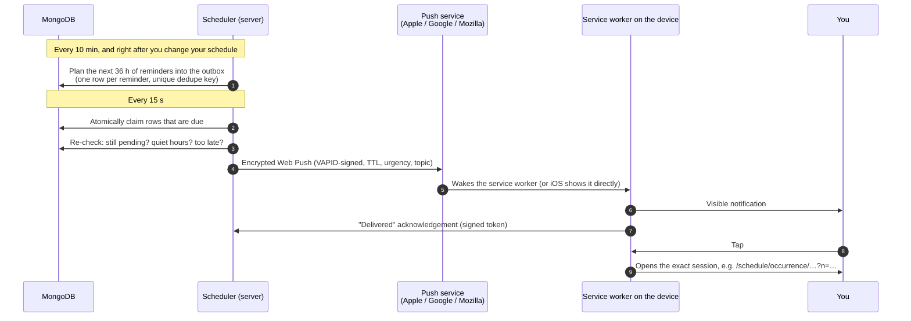

# Notifications and reminders

This document covers how buZZprep delivers reminders, what is and isn't possible on iPhone, how to set it up, and how to test it on a real device.

> **Verification status.** The reminder pipeline is implemented and covered by automated tests (planning, deduplication, quiet hours, conditions, retries, expiry, payload format, subscription cleanup). **It has not yet been tested on a physical iPhone with the app installed to the Home Screen.** Until the [real-device test plan](#real-device-test-plan-iphone) below has been run and passes, treat background delivery on iOS as unverified.

## At a glance

| Where the app runs                                 | Reminders while the app is closed? | Notes                                                                                         |
| -------------------------------------------------- | ---------------------------------- | --------------------------------------------------------------------------------------------- |
| iPhone / iPad, **added to Home Screen**, iOS 16.4+ | Yes (Web Push)                     | Permission must be granted inside the installed app. No action buttons on iOS.                |
| iPhone / iPad, iOS 18.4+                           | Yes, more robust                   | Payloads use Declarative Web Push, so iOS can show them even if the service worker can't run. |
| iPhone / iPad, **Safari tab** (not installed)      | No                                 | iOS only allows Web Push for Home Screen web apps. The app explains how to install.           |
| Android (Chrome, Edge, Firefox)                    | Yes                                | "Mark done" and "Snooze" buttons work from the notification.                                  |
| Desktop Chrome, Edge, Firefox; Safari on macOS     | Yes, while the browser is running  |                                                                                               |

## How delivery works

Reminders are planned and sent **by the server**. The browser never holds a timer for a future reminder: a closed or suspended web app runs no JavaScript, so timers in the page or service worker cannot be relied on (iOS suspends them aggressively).



1. **Rules.** Reminder rules come from your routine (each activity can have "before", "at start" and "if not done" reminders) and from standalone rules (daily planning, journal prompts, sleep, weekly review, milestones). They are stored per user in the `reminders` collection.
2. **Planning.** `planNotifications()` in `packages/shared/src/reminders/planner.ts` expands the rules against your agenda (including day modes, moved sessions and the gradual bedtime shift) for a rolling 36-hour window. The result is written to the `notifications` collection, the **outbox**. Each row has a deterministic `dedupeKey` (`rule:occurrence@time`) with a unique index, so re-planning is idempotent: it never creates duplicates, and reminders for sessions you deleted or moved are cancelled.
3. **Dispatch.** A loop on the server (`APP_ROLE=all` or `worker`) claims due rows atomically with a short lease, so a crash mid-send or two workers running at once can't double-send. Before sending it re-checks the row's condition:
   - _upcoming / start / overdue_ reminders are dropped if the session was already completed or skipped (`skipped_condition`);
   - the _missed sessions_ digest is only sent if something still needs a decision;
   - anything later than its tolerance (for example a "starting now" reminder more than 15 minutes late after a server outage) is marked `expired` instead of arriving late and confusing.
4. **Send.** The payload goes to every device you enabled, signed with the server's VAPID private key, which never leaves the server. Failed sends are retried with backoff (1, 2, 4 minutes; 3 attempts). A `404`/`410` from the push service means the device unsubscribed (for example, you deleted the Home Screen app); that device is removed.
5. **On the device.** The service worker shows the notification and reports "delivered". Tapping it opens the exact session or page. On Android and desktop, **Mark done** and **Snooze** work straight from the notification.

The schedule lives in the database, not in memory: if the server restarts, the next tick picks up where it left off, and planning runs again at startup.

### Timing

- The server checks for due reminders every 15 seconds (`SCHEDULER_TICK_SECONDS`), so a reminder leaves the server within about 15 seconds of its planned time.
- After that, delivery depends on the push service and the phone. It is usually quick, but it is **best-effort**: Low Power Mode, Focus, a poor connection or the device being off can delay or drop a notification. Each reminder has a time-to-live suited to its purpose (15 minutes for "starting now", up to 12 hours for a weekly review), after which the push service discards it rather than delivering it late.
- Web notifications are not alarms. They can't bypass silent mode or Focus, and can't play a custom sound.

### Payload format

Payloads use the [Declarative Web Push](https://webkit.org/blog/16535/meet-declarative-web-push/) JSON format (`"web_push": 8030`) with `"mutable": true`:

- On iOS/iPadOS 18.4+ the system can display the notification **even if the service worker is evicted or fails**, which makes delivery noticeably more robust.
- Because the payload is mutable, the service worker still receives a `push` event and shows the notification itself, which keeps click handling and delivery acknowledgements the same on every platform.
- Browsers without declarative support receive the same JSON in a normal `push` event and the service worker renders it.

`apps/server/src/modules/notifications/payload.ts` builds the payload; `apps/web/src/sw.ts` handles it.

## iOS feasibility analysis

### What iOS supports

- **Web Push for Home Screen web apps** since iOS/iPadOS 16.4. The site must be added to the Home Screen and opened from there; permission can only be requested in response to a tap inside the installed app. buZZprep's **Turn on reminders** button does exactly this.
- **Declarative Web Push** since iOS/iPadOS 18.4. The OS can display a push without running any JavaScript.
- Since iOS 26, every site added to the Home Screen opens as a web app by default ("Open as Web App" is on). On earlier versions, the site's manifest (`display: standalone`) does the same.
- Notifications follow **Focus** modes and the **Notification Summary**, and can be managed per app in Settings → Notifications.

### What iOS does not support, and what buZZprep does instead

| Limitation on iOS                                                                           | Effect                                                                | What buZZprep does                                                                                                                                                                                                               |
| ------------------------------------------------------------------------------------------- | --------------------------------------------------------------------- | -------------------------------------------------------------------------------------------------------------------------------------------------------------------------------------------------------------------------------- |
| No push at all in a Safari tab                                                              | Reminders can't reach someone who hasn't installed the app            | The Notifications screen detects this and shows a four-step install guide instead of a broken button.                                                                                                                            |
| No notification **action buttons**                                                          | Can't "Mark done" from the banner                                     | Tapping opens that session, with one-tap **Mark done**, **Skip**, **+15 min** and **Find a free slot**.                                                                                                                          |
| No silent pushes; every push must show a notification                                       | The app can't refresh itself in the background                        | Every push is a visible notification. The server decides what to send; the app refreshes its data when you open it.                                                                                                              |
| No Background Sync, Periodic Background Sync or Background Fetch                            | Changes made offline can't upload while the app is closed             | Marking sessions done or skipped while offline is queued and sent as soon as the app is open and online. Conditions are re-checked on the server when each reminder is sent.                                                     |
| No way to schedule notifications locally (the Notification Triggers proposal never shipped) | The phone can't "remember" a reminder by itself                       | All scheduling is server-side. The server must be reachable from the internet over HTTPS.                                                                                                                                        |
| Notifications can't bypass silent mode or Focus, and have no custom sounds                  | A wake-up reminder can be missed                                      | Use the iPhone **Clock** alarm as your primary wake-up alarm. buZZprep's wake-up reminder is a backup. Wake-up and bedtime-routine reminders are the only ones that ignore quiet hours, because they follow your sleep schedule. |
| The installed app has its own storage, separate from Safari                                 | Signing in inside Safari doesn't sign you in inside the installed app | The install guide says to sign in again inside the installed app.                                                                                                                                                                |
| Deleting the Home Screen icon deletes the push subscription                                 | That device stops receiving reminders                                 | The server removes the device when Apple reports it gone. Reinstall and tap **Turn on reminders** again.                                                                                                                         |

### Closest reliable alternatives for time-critical reminders

These are proposals, not built yet. See [ROADMAP.md](ROADMAP.md).

- **Calendar subscription (recommended next step).** A private, revocable calendar feed (iCalendar with alarms) that you subscribe to in the iOS Calendar app. Calendar alerts are scheduled locally by iOS, so they fire offline and with the phone's own reliability. Trade-off: a feed URL is a bearer secret, and anything in it is visible to Apple's Calendar sync. It would be opt-in, with generic titles by default.
- **iPhone alarms for sleep and wake-up.** These are the only things that should behave like an alarm clock. buZZprep shows the target times; set them once in the Clock app.

## Setting it up

### Server

1. Serve the app over **HTTPS** on a real domain. Service workers and Web Push require a secure context, and iOS rejects certificates it doesn't trust. See [DEPLOYMENT.md](DEPLOYMENT.md).
2. Generate VAPID keys **once** per deployment and add them to `.env`:

   ```bash
   npm run vapid:generate        # or, with Docker:
   docker compose run --rm --no-deps app node apps/server/dist/generate-vapid.js
   ```

   Set `VAPID_SUBJECT` to a `mailto:` address or `https:` URL you control. Push services use it to contact you about problems. Changing the keys later invalidates every device's subscription.

3. Keep the server clock synchronised (NTP). VAPID signatures carry an expiry time, and a skewed clock makes push services reject them.

The public key is served to the app at `GET /api/v1/push/config`. The private key is only read by the server process.

### iPhone or iPad

1. Open your buZZprep address in **Safari**.
2. Tap the **•••** button next to the address bar, then **Share**. (On older iOS versions, or with a tab bar showing, tap the Share button directly.)
3. Choose **Add to Home Screen**. Keep **Open as Web App** on if you see it, then tap **Add**.
4. Open buZZprep **from the Home Screen icon** and sign in.
5. Go to **Profile → Notifications → Turn on reminders** and allow notifications.
6. Tap **Send a test**, then lock the phone. It should arrive within a few seconds.

### Android and desktop

Open the app, sign in, go to **Profile → Notifications → Turn on reminders**. Installing the app is optional but recommended on Android.

## Real-device test plan (iPhone)

Run this once per deployment, and again after changing the domain, VAPID keys, or the service worker. Record results in an issue or in this file. The **Recent deliveries** list on the Notifications screen shows the server-side status of each reminder, which helps separate server problems from device problems.

Before you start: iOS 18.4 or later is recommended; note the exact version. Turn off Focus and Low Power Mode unless a test says otherwise. Tests 5 and 13 need a second signed-in device (any browser) to press **Send a test**, because a test goes to all of your devices.

| #   | Test                                                                              | Expected                                                                                                  |
| --- | --------------------------------------------------------------------------------- | --------------------------------------------------------------------------------------------------------- |
| 1   | In Safari (not installed), open Profile → Notifications                           | Install guide is shown; no "Turn on reminders" button.                                                    |
| 2   | Installed app: **Turn on reminders**                                              | iOS permission prompt appears; after allowing, the phone is listed under **Devices receiving reminders**. |
| 3   | **Send a test** with the app open                                                 | Notification appears; **Recent deliveries** shows _Sent_, then _Delivered_.                               |
| 4   | Send a test, then immediately swipe the app away and lock the phone               | Notification appears on the lock screen.                                                                  |
| 5   | Restart the phone, don't open the app, send a test from another device            | Notification appears.                                                                                     |
| 6   | Create an activity starting in 5 minutes with "at start" reminder; close the app  | "Starting now" notification within about a minute of the start time.                                      |
| 7   | Same as 6, but mark the session done before it starts                             | No reminder; **Recent deliveries** shows _Not needed_.                                                    |
| 8   | Tap a session reminder                                                            | App opens on that session. **Mark done** works in one tap.                                                |
| 9   | Move a session 15 minutes later (**+15 min** on the session screen)               | The "starting now" reminder arrives at the new time, not the old one.                                     |
| 10  | Set quiet hours covering the next few minutes and schedule a reminder inside them | Not delivered; shown as _Quiet hours_. The wake-up reminder is still delivered.                           |
| 11  | Turn on a Focus mode that doesn't allow buZZprep, send a test                     | Delivered silently (shows in Notification Centre), per iOS rules.                                         |
| 12  | Airplane mode for 30 minutes across a "starting now" reminder, then reconnect     | The stale reminder is not shown late (its 15-minute TTL expired).                                         |
| 13  | Delete the Home Screen icon, then send a test from another device                 | The deleted phone disappears from **Devices receiving reminders** once the push service reports it gone.  |
| 14  | Reinstall and turn reminders on again                                             | Works as in tests 2 and 3.                                                                                |

## Troubleshooting

- **No "Turn on reminders" button on iPhone.** You're in a Safari tab. Install the app (steps above) and open it from the Home Screen.
- **The permission prompt doesn't appear.** You previously denied it. Go to iOS Settings → Notifications → buZZprep and allow notifications, then reopen the app.
- **Test says sent but nothing appears.** Check Focus, Notification Summary and Settings → Notifications → buZZprep. Check the **Recent deliveries** status. On the server, look for push errors in the logs (`docker compose logs app`). A `403` usually means a bad `VAPID_SUBJECT` or a skewed server clock.
- **Reminders stopped after changing domain or VAPID keys.** Subscriptions belong to one origin and one key pair. Reinstall the app on each device and turn reminders on again.
- **Reminders arrive for something already done.** Done/skip is checked on the server when the reminder is sent. If you marked it done while offline, the change is uploaded the next time the app is open and online.
- **Reminders arrive at the wrong time.** Check Profile → Time zone. All times are stored in your profile's time zone, not the device's.

## Notification statuses

| Status              | Meaning                                                                    |
| ------------------- | -------------------------------------------------------------------------- |
| `pending`           | Planned, waiting for its time.                                             |
| `processing`        | Claimed by the scheduler, being sent (or waiting to retry).                |
| `sent`              | Accepted by at least one device's push service.                            |
| `failed`            | All attempts failed.                                                       |
| `cancelled`         | No longer planned (the session was moved or deleted, or the rule changed). |
| `suppressed`        | Fell in quiet hours, or the reminder type or category is turned off.       |
| `skipped_condition` | Not needed any more (for example, the session was already done).           |
| `expired`           | Too late to be useful, so it was not sent.                                 |
| `no_subscription`   | You have no devices with reminders turned on.                              |

Rows are deleted automatically 30 days after their planned time.

## Configuration reference

| Variable                     | Default | Purpose                                                   |
| ---------------------------- | ------- | --------------------------------------------------------- |
| `VAPID_PUBLIC_KEY`           | —       | Public key, sent to browsers to create subscriptions.     |
| `VAPID_PRIVATE_KEY`          | —       | **Secret.** Signs pushes. Server only.                    |
| `VAPID_SUBJECT`              | —       | `mailto:` or `https:` contact for push services.          |
| `APP_ROLE`                   | `all`   | `all`, `api` (no scheduler) or `worker` (scheduler only). |
| `SCHEDULER_TICK_SECONDS`     | `15`    | How often due reminders are dispatched.                   |
| `RECONCILE_INTERVAL_MINUTES` | `10`    | How often every user's reminder window is re-planned.     |
| `NOTIFICATION_HORIZON_HOURS` | `36`    | How far ahead reminders are planned.                      |

Per-user settings (Profile → Notifications): reminder types on or off, quiet hours, muted categories, default snooze length and 12/24-hour time.
