# Screens and wireframes

Screenshots of what's built (phases 2–4), followed by wireframes for the next phases. Screenshots use sample data.

## Design principles

- **Calm and neutral.** A light grey "paper" background and white surfaces; indigo appears only for _now_ and for the primary action on a screen, so it always means "this one".
- **The day is the hero.** Home opens on a strip of the whole day (04:00 to 04:00) and a Now/Next card. Everything else is secondary.
- **Lists like iOS Settings.** Grouped lists with clear rows instead of a wall of cards, round checkboxes in the spirit of Things and Reminders, and bottom sheets on phones that become dialogs on desktop.
- **No guilt.** Missed sessions "need a decision" rather than counting as failures; recovery and low-energy days are first-class.
- **Motion only in response to you.** Sheets slide, checkboxes fill; nothing animates on its own. Reduced-motion settings are respected.
- **Phone first.** An ink top bar around the Dynamic Island and a bottom tab bar (Home, Schedule, Learn, Journal, Profile), safe-area aware, no horizontal scrolling at 320 px. Tablets get a narrow ink rail, and laptops an ink sidebar with plan shortcuts, plan progress and the account menu.

## Built

### Home

<table>
  <tr>
    <td>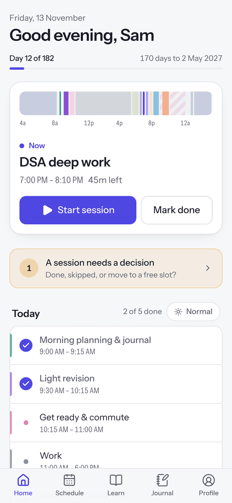</td>
    <td>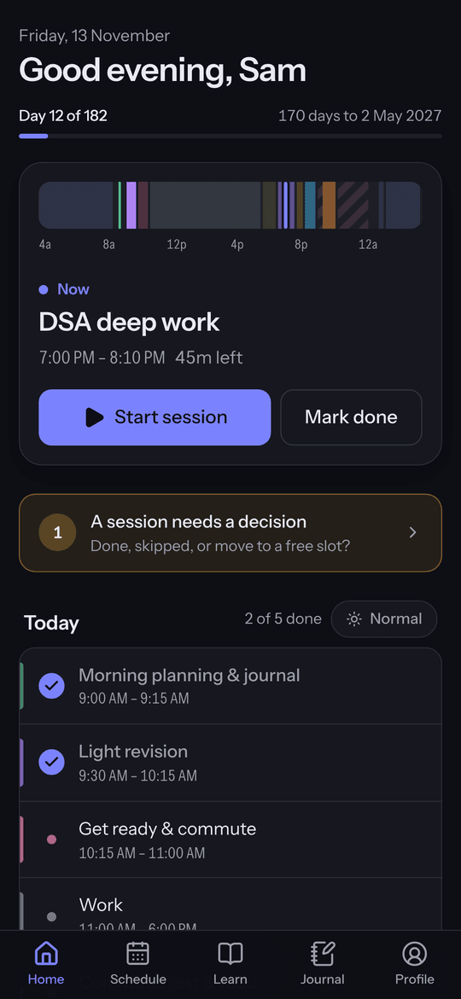</td>
    <td>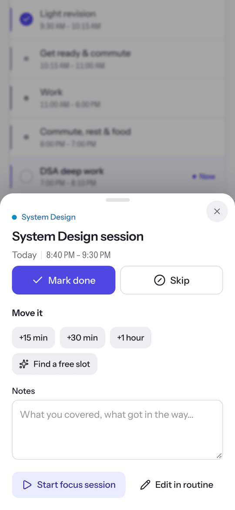</td>
  </tr>
</table>

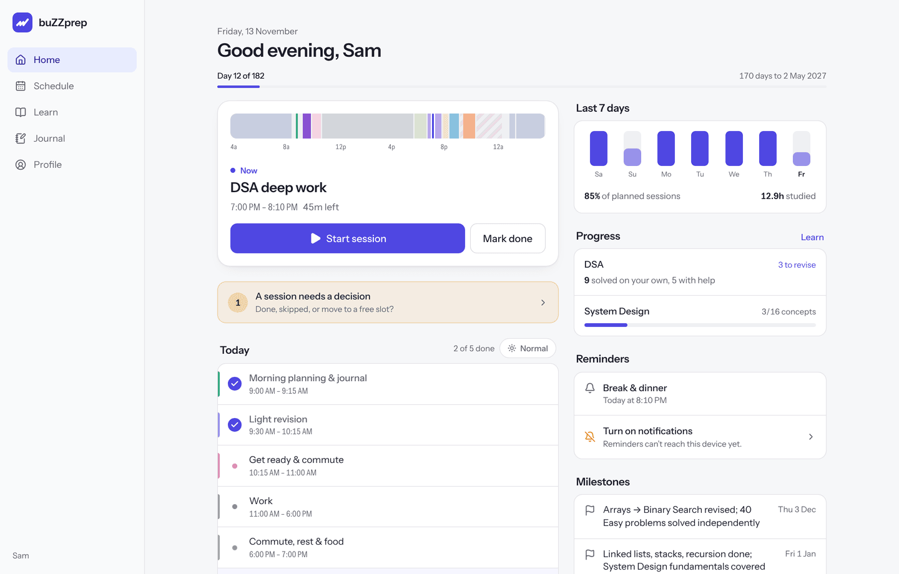

### Schedule

<table>
  <tr>
    <td>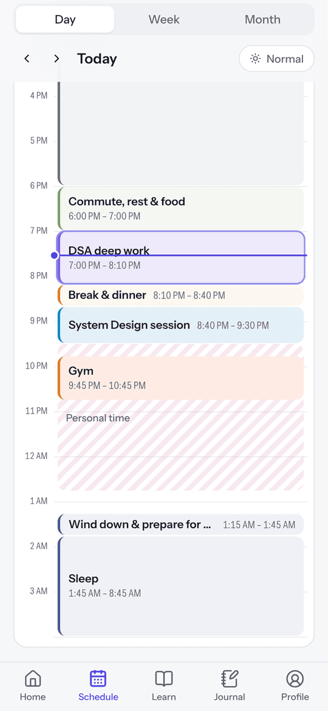</td>
    <td>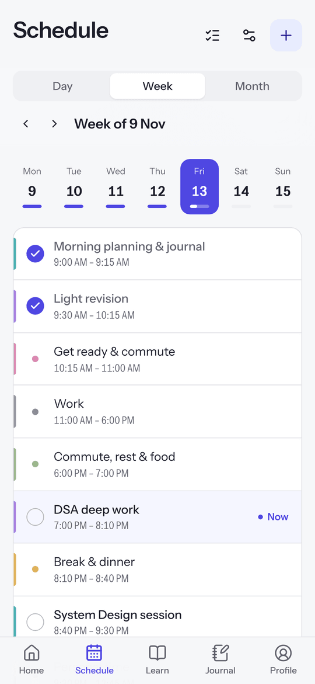</td>
    <td>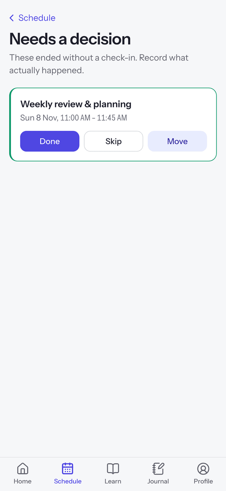</td>
  </tr>
  <tr>
    <td>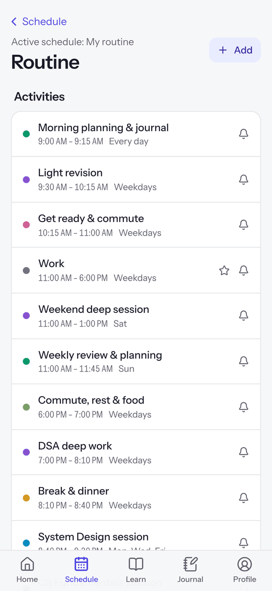</td>
    <td>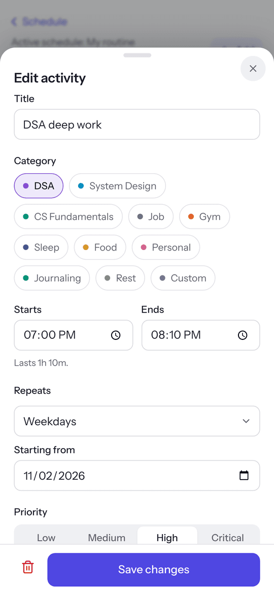</td>
    <td>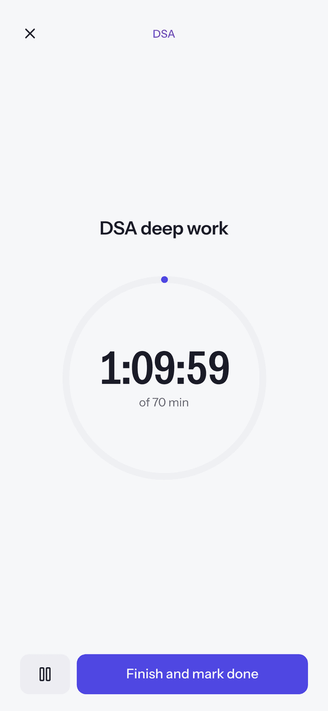</td>
  </tr>
</table>

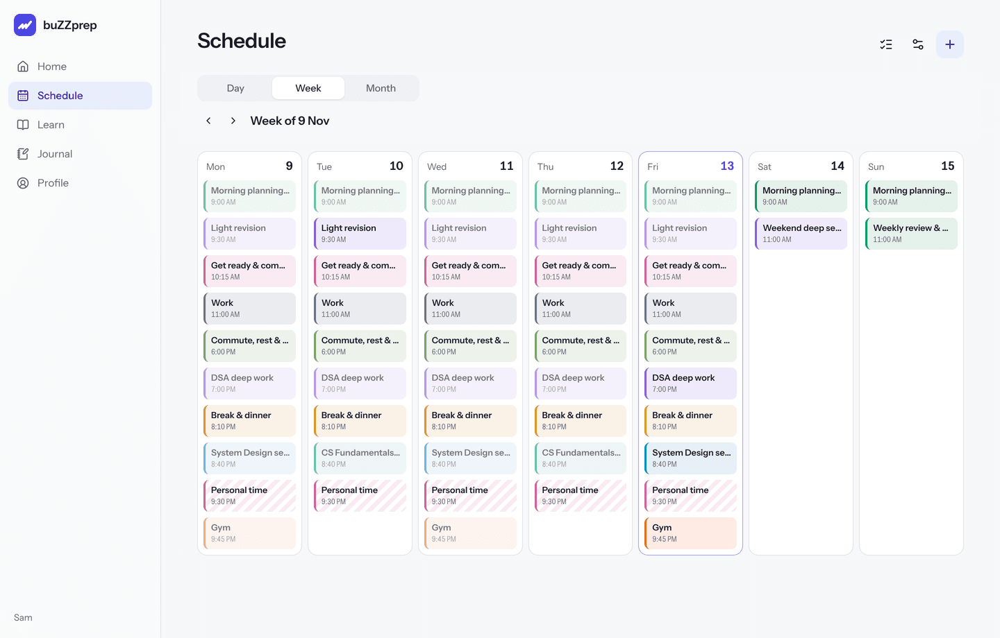

### Setup and notifications

<table>
  <tr>
    <td>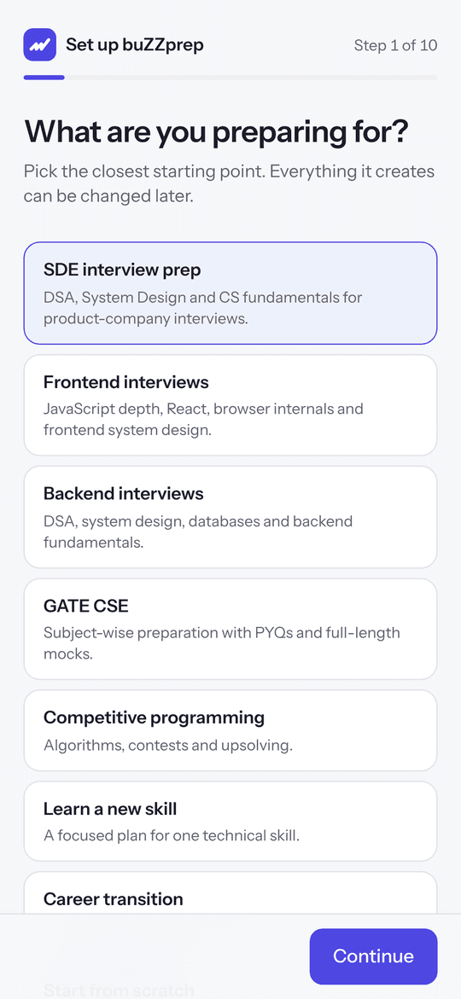</td>
    <td>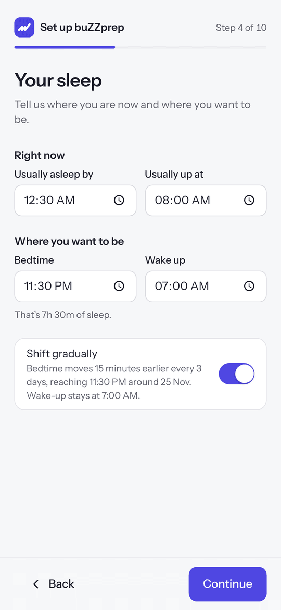</td>
    <td>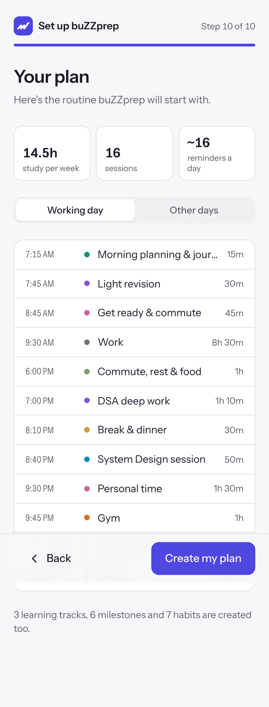</td>
    <td>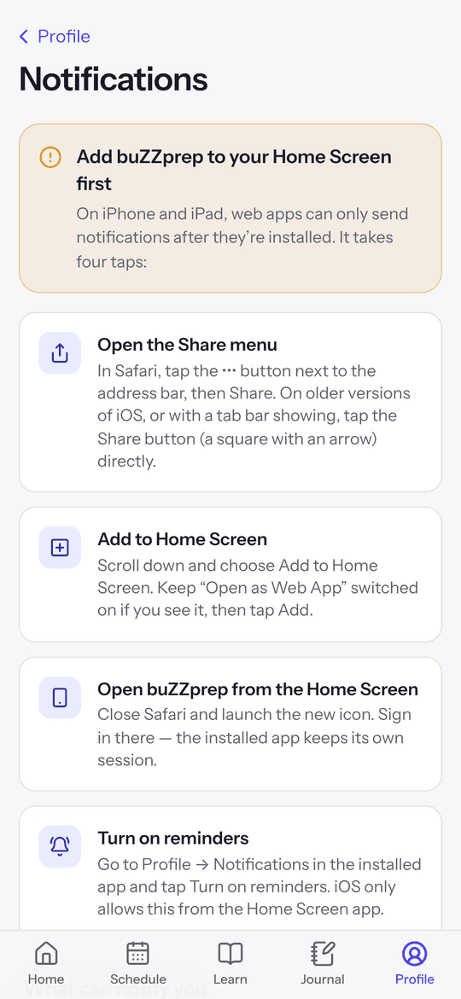</td>
  </tr>
</table>

## Next phases

### Learn (phase 5)

```
┌─────────────────────────────────┐
│ Learn                        ＋ │
│                                 │
│ Revise today                  3 │   ← due from spaced revision
│ ┌─────────────────────────────┐ │
│ │ ○ Two Sum         Easy  ▸   │ │   tap → solve again, record outcome
│ │ ○ Sliding window  concept ▸ │ │
│ │ ○ Consistent hashing      ▸ │ │
│ └─────────────────────────────┘ │
│                                 │
│ Tracks                          │
│ ┌─────────────────────────────┐ │
│ │ DSA              6 / 15   ▸ │ │   topics done / total
│ │ ▓▓▓▓▓▓░░░░░░░░░             │ │
│ │ 9 on your own · 5 with help │ │   independent vs assisted, never mixed
│ ├─────────────────────────────┤ │
│ │ System Design    3 / 22   ▸ │ │
│ ├─────────────────────────────┤ │
│ │ CS Fundamentals  2 / 15   ▸ │ │
│ └─────────────────────────────┘ │
│                                 │
│ This week   4h 10m studied      │
├─────────────────────────────────┤
│  Home  Schedule  Learn  Journal  Profile │
└─────────────────────────────────┘

Log a problem (sheet)
┌─────────────────────────────────┐
│ Link   leetcode.com/problems/…  │
│ Difficulty  [Easy][Medium][Hard]│
│ How did it go?                  │
│  ( ) Solved on my own           │
│  ( ) Solved with hints          │
│  ( ) Needed the editorial       │
│  ( ) Not solved yet             │
│ Time  25 min    Topic  Hashing ▾│
│ Approach / notes …              │
│                     [ Save ]    │
└─────────────────────────────────┘
```

### Journal (phase 6)

```
┌─────────────────────────────────┐
│ Journal                  ⌕   ＋ │
│ [Morning] [Evening] [Weekly] [All]
│                                 │
│ Today                           │
│ ┌─────────────────────────────┐ │
│ │ ☀ Morning      Written ✓    │ │
│ │ ☾ Evening      Write now ▸  │ │   prompt-led, one question per field
│ └─────────────────────────────┘ │
│                                 │
│ Earlier                         │
│ ┌─────────────────────────────┐ │
│ │ Thu 12 Nov   Evening   😊 4 │ │   mood + energy
│ │ "Finally got sliding window…│ │   Newsreader for all text
│ ├─────────────────────────────┤ │
│ │ Sun 8 Nov    Weekly review  │ │
│ └─────────────────────────────┘ │
│                                 │
│ Export  Markdown · JSON         │   private: never shared or public
└─────────────────────────────────┘
```

### Habits (phase 7)

```
┌─────────────────────────────────┐
│ Habits                       ＋ │
│ ┌─────────────────────────────┐ │
│ │ Gym          ● ● ○ ● · · ·  │ │   · = rest day, not a miss
│ │ 3 of 3 this week            │ │
│ ├─────────────────────────────┤ │
│ │ In bed by target  ● ○ ● ●   │ │
│ │ 80% over 4 weeks            │ │   consistency, not a fragile streak
│ ├─────────────────────────────┤ │
│ │ Journal      ○ ○ ○ ● ●      │ │
│ │ Welcome back — 2 in a row   │ │   comeback message instead of reset
│ └─────────────────────────────┘ │
└─────────────────────────────────┘
```

### Career (phase 8)

```
┌─────────────────────────────────┐
│ Career                       ＋ │
│ Interested 4 · Applied 2 · Interviewing 1
│                                 │
│ Dream                           │
│ ┌─────────────────────────────┐ │
│ │ Company A   Preparing     ▸ │ │
│ │ Company B   Interested    ▸ │ │
│ └─────────────────────────────┘ │
│ Target                          │
│ ┌─────────────────────────────┐ │
│ │ Company C   Technical int. ▸│ │   next round: Tue 10:00
│ │ Company D   Applied        ▸│ │   referral requested
│ └─────────────────────────────┘ │
└─────────────────────────────────┘

Application detail: stage history · referral & contacts · rounds
(questions asked, feedback, lessons learned → "Add to Learn")
```
